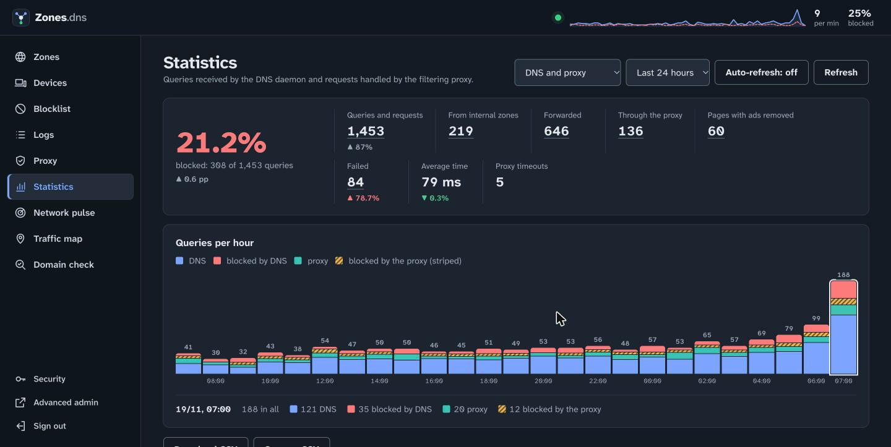
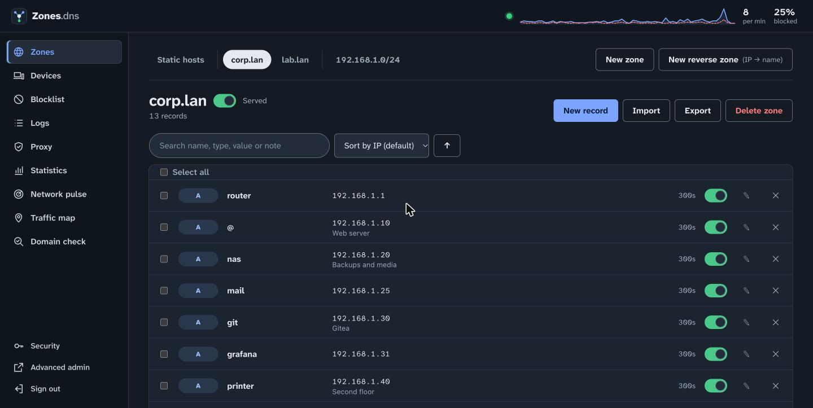
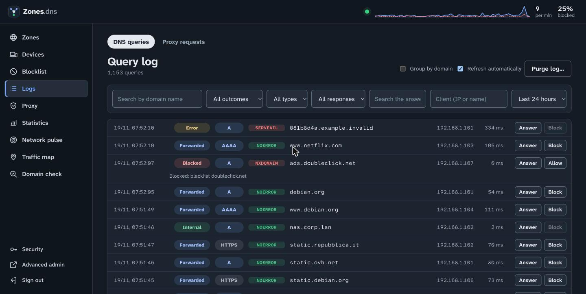
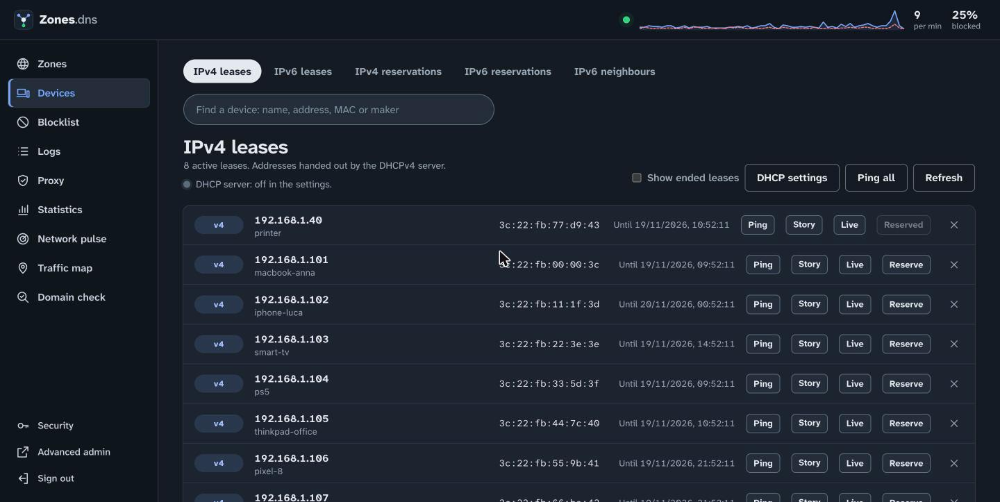
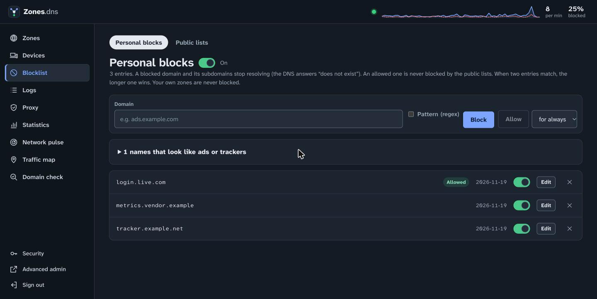
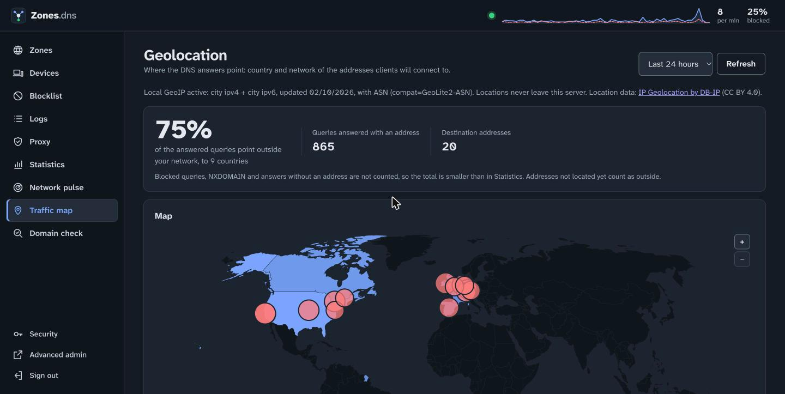

# Zones.dns

**Your network's DNS, DHCP and ad blocking in one self-hosted app.** Run your own zones, block ads and trackers for every device, and see what your network is doing, from a fast web interface.



## Why Zones.dns

- **One place for the name side of your network.** Internal zones, static hosts, a filtering resolver, DHCP and an ad-blocking proxy, managed from one GUI instead of five config files.
- **Changes are live.** Edit a record in the GUI and the DNS daemon answers with it within a second.
- **You see everything.** Every query with its full answer, per-device history, statistics, and a map of where your traffic goes. With a local GeoIP database, locations never leave your server.
- **Safe by default.** Sign-in is encrypted in the browser, a second factor (authenticator app or passkey) is required, and the dangerous actions ask for it again.
- **Easy to run.** SQLite to start, PostgreSQL or MariaDB for production, Redis optional.

## What it does

| | |
|---|---|
| **Authoritative DNS** | Forward and reverse zones, 13 record types with a guided form, wildcards, zone file import and export, automatic PTR records, RFC 2136 dynamic updates signed with TSIG. |
| **Resolver** | Forwards the rest to your upstreams with failover, DNSSEC validation, caching with prefetch, rate limiting, and a check for suspicious queries (tunnelling, random names). |
| **Ad and tracker blocking** | Public blocklists (about 1.3 million domains) plus your own blocks and exceptions, a one-click *Block* from the query log. |
| **Ad-blocking proxy** | Filters pages for the devices that use it: hides ad slots, stops popups, optional HTTPS inspection. EasyList, EasyPrivacy and uBlock filters are one switch each. Devices find it by themselves (WPAD) or with an Apple profile. |
| **DHCP** | DHCPv4, DHCPv6 and IPv6 router advertisements, reservations, prefix delegation. Leases become DNS names. |
| **Encrypted DNS** | DNS over HTTPS and over TLS, announced to clients with DDR and DNR so they upgrade by themselves. |
| **Insight** | Query log, statistics, a live *Network pulse*, the story of each device, a domain audit (DNS, DNSSEC, mail, TLS, headers), and a geolocation map. |
| **Security** | Encrypted sign-in, authenticator app and passkeys, a fresh second factor to delete a zone or open the admin. |
| **Phone and tablet ready** | The interface adapts to small screens. |

## A look inside

| | |
|---|---|
|  **Zones and records** |  **Query log**, with one-click blocking |
|  **Devices and DHCP** |  **Blocklist**: yours and the public ones |



## Try it in five minutes

You need Python 3.12+ and Node.js.

```sh
python3 -m venv .venv && .venv/bin/pip install -r backend/requirements.txt
cd backend
cp .env.example .env
../.venv/bin/python manage.py migrate
../.venv/bin/python manage.py createsuperuser          # staff and superuser: needed for the GUI
../.venv/bin/python manage.py runserver 8000           # API
../.venv/bin/python manage.py rundns --port 5353       # DNS (port 53 needs root)
cd ../frontend && npm install && npx ng serve          # GUI at http://localhost:4200
dig @127.0.0.1 -p 5353 www.corp.lan
```

Sign in at <http://localhost:4200>, add a zone, and query it with `dig`. For the blocklists run `python manage.py import_blocklist`.

## Put it in production

[INSTALL.md](INSTALL.md) is the step-by-step guide: PostgreSQL or MariaDB, Redis, nginx with HTTP/3, systemd or supervisor, TLS, port 53 without root, firewall, backups, hardening and updates. Ready-made units, nginx configs and cron jobs are in [deploy/](deploy/).

## Documentation

- [docs/REFERENCE.md](docs/REFERENCE.md): every setting, the encrypted sign-in, MFA, blocklists, geolocation, caching, DoH/DoT, DHCP.
- [INSTALL.md](INSTALL.md): production install.
- [CHANGELOG.md](CHANGELOG.md): what changed in each release.
- API: OpenAPI schema at `/api/schema/`, docs at `/api/docs/` (staff only).

Built with Python (dnslib), Django and DRF, and Angular. Tests: `python manage.py test zones` and `ruff check .` in `backend/`, `npm test` in `frontend/`.

## Licence

BSD 3-Clause, see [LICENSE](LICENSE). The libraries used keep their own licences. The DB-IP GeoIP databases, downloaded separately, are CC BY 4.0 ("IP Geolocation by DB-IP") and are not part of the repository.
